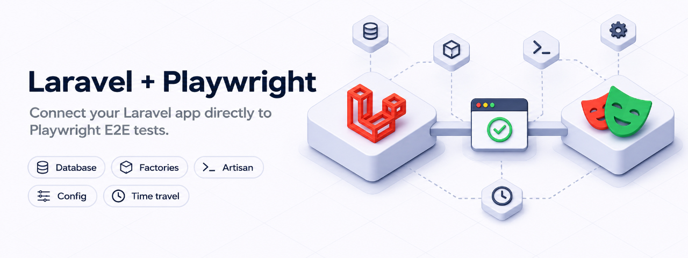

# Laravel and Playwright E2E Testing

A **Laravel and Playwright library** for end-to-end (E2E) browser testing.

Use Laravel factories, Artisan commands, database queries, configuration and time travel from your [Playwright](https://playwright.dev/) tests.

This package has two parts: a Laravel package that exposes testing endpoints, and a TypeScript fixture that calls them. Run your tests against a dedicated server and database; the fixture cleans up each test's configuration, clock and boot functions automatically.


## Contents

- [Requirements](#requirements)
- [Quick start](#quick-start)
- [API reference](#api-reference)
- [Reusable fixtures and PHP helpers](#reusable-fixtures-and-php-helpers)
- [Database setup and parallel tests](#database-setup-and-parallel-tests)
- [Configuration, time and boot functions](#configuration-time-and-boot-functions)
- [Environment and server configuration](#environment-and-server-configuration)
- [Security and custom endpoints](#security-and-custom-endpoints)
- [CI](#ci)
- [Troubleshooting](#troubleshooting)
- [Laravel Boost](#laravel-boost)
- [Upgrading from v1](#upgrading-from-v1)

## Requirements

- PHP 8.3+
- Laravel 12 or 13
- Node.js 22+
- Playwright ^1.58.2

## Quick start

Run these commands from your existing Laravel application's root.

### 1. Install both packages and a browser

```bash
composer require --dev saucebase/laravel-playwright
npm install --save-dev @playwright/test @saucebase/laravel-playwright
npx playwright install chromium
```

Laravel discovers the provider automatically. To publish the configuration:

```bash
php artisan vendor:publish --tag=laravel-playwright-config
```

This creates `config/laravel-playwright.php`.

### 2. Create the test environment

```bash
php artisan playwright:env
```

This creates `.env.e2e` from `.env`, with a separate SQLite database (requires PHP’s SQLite extension), `APP_ENV=e2e`, and `APP_URL=http://localhost:8100`.

> [!WARNING]
> `.env.e2e` contains your app's secrets. Add these entries to `.gitignore`:
>
> ```gitignore
> .env.e2e
> .env.e2e.backup
> /test-results/
> /playwright-report/
> ```

Use a dedicated test database, never your development or production database.

### 3. Configure Playwright

Create or update `playwright.config.ts` in the app root:

```ts
import { defineConfig } from '@playwright/test';
import { laravelServer, type LaravelOptions } from '@saucebase/laravel-playwright';

export default defineConfig<LaravelOptions>({
    testDir: './tests/e2e',
    use: {
        baseURL: 'http://localhost:8100',
    },
    webServer: laravelServer(),
});
```

`laravelServer()` migrates the E2E database, starts Laravel in the `e2e` environment, and waits for it to respond. Playwright manages the server's lifecycle. You do not need to start Herd, Docker or a separate Artisan server for this suite.

Keep `baseURL` equal to `APP_URL` in `.env.e2e`. The client automatically uses `${baseURL}/playwright` for its testing endpoints.

### 4. Write your first test

Create `tests/e2e/example.spec.ts`:

```ts
import { expect } from '@playwright/test';
import { test } from '@saucebase/laravel-playwright';

test('opens the app and creates a user', async ({ page, laravel }) => {
    const user = await laravel.factory('User', {
        email: `e2e-${crypto.randomUUID()}@example.com`,
    });

    const rows = await laravel.select(
        'SELECT id FROM users WHERE email = :email',
        { email: user.email },
    );

    expect(rows).toEqual([{ id: user.id }]);

    const response = await page.goto('/');
    expect(response?.status()).toBe(200);
});
```

Import `test` from this package to get the `laravel` fixture; import `expect` from Playwright. Use your app's factory and page URL in the example.

### 5. Run it

```bash
npx playwright test
```

You should see one passing test. For interactive debugging, use `npx playwright test --ui`.

If your app requires compiled frontend assets, run `npm run build` before testing.

## API reference

All methods below are available on the `laravel` fixture and return promises.

| Method | Purpose | Result |
| --- | --- | --- |
| `artisan(command, parameters?)` | Run an Artisan command | `{ code, output }` |
| `factory(model, attributes?, count?)` | Create models using their factories | One object, or an array when `count` is provided |
| `select(sql, bindings?, options?)` | Read database rows | Array of objects |
| `query(sql, bindings?, options?)` | Execute a database statement | `{ success }` |
| `truncate(connections?)` | Truncate tables on the selected connections | Await completion |
| `callFunction<T>(callable, arguments?)` | Call PHP once and decode its JSON result | `T` |
| `config(key, value)` | Change configuration for this test | Await completion |
| `travel(datetime)` | Set Laravel's clock for this test | Await completion |
| `registerBootFunction(callable)` | Run PHP at boot on subsequent requests in this test | Await completion |
| `tearDown()` | Remove this test's config, clock and boot functions | Called automatically by the fixture |

### Artisan

Pass options in the command string:

```ts
const result = await laravel.artisan('db:seed --class=DatabaseSeeder');
expect(result.code).toBe(0);
```

Commands run from your application's root. Inspect `code` to check whether the command succeeded. Do not pass CLI tokens such as `['--class', 'DatabaseSeeder']` as the second argument: Laravel expects named arguments and options, not a token list.

### Factories

```ts
const user = await laravel.factory('User', {
    email: `e2e-${crypto.randomUUID()}@example.com`,
});
const users = await laravel.factory('User', {}, 3);
const otherUser = await laravel.factory(String.raw`App\Models\User`);
```

A short name resolves to `App\Models\<Name>`. For a module or package model, pass its full class name. Models must expose Laravel's `factory()` method. Use a PHP helper for factory states or relationships.

### Queries

```ts
const users = await laravel.select(
    'SELECT id, email FROM users WHERE email = :email',
    { email: user.email },
);

await laravel.query('UPDATE users SET name = ? WHERE id = ?', ['Updated', user.id]);
```

Both methods accept a third argument `{ connection: 'connection_name' }`. `query()` also accepts `{ unprepared: true }` for raw statements; it cannot be combined with bindings. Use bindings for values.

### PHP functions

```ts
const appName = await laravel.callFunction<string>('config', ['app.name']);
const credentials = await laravel.callFunction<{ email: string; password: string }>(
    String.raw`Tests\Support\E2eUsers::create`,
);
```

Pass positional arguments as an array, or named arguments as an object. The callable must exist and be autoloadable in the app. Results must be JSON-serializable; TypeScript's generic describes the expected shape, it does not validate the response.

## Reusable fixtures and PHP helpers

As a suite grows, give it one fixture entry point. Keep application-specific setup in PHP helpers instead of repeating SQL or model details in TypeScript.

For example, create `tests/Support/E2eUsers.php`. A standard Laravel app already autoloads the `Tests\` namespace for development:

```php
<?php

namespace Tests\Support;

use App\Models\User;
use Illuminate\Support\Facades\Hash;
use Illuminate\Support\Str;

class E2eUsers
{
    /** @return array{email: string, password: string} */
    public static function create(): array
    {
        $password = Str::random(24);
        $user = User::factory()->create([
            'email' => 'e2e-'.Str::uuid().'@example.com',
            'password' => Hash::make($password),
        ]);

        return ['email' => $user->email, 'password' => $password];
    }
}
```

Create `tests/e2e/fixtures.ts`:

```ts
import { test as base } from '@saucebase/laravel-playwright';
export { expect } from '@playwright/test';

type Credentials = { email: string; password: string };

export const test = base.extend<{ credentials: Credentials }>({
    credentials: async ({ laravel }, use) => {
        const credentials = await laravel.callFunction<Credentials>(
            String.raw`Tests\Support\E2eUsers::create`,
        );
        await use(credentials);
    },
});
```

Then import your fixture in specs:

```ts
import { test, expect } from './fixtures';

test('prepares an account', async ({ credentials, laravel }) => {
    const users = await laravel.select(
        'SELECT email FROM users WHERE email = :email',
        { email: credentials.email },
    );
    expect(users).toEqual([{ email: credentials.email }]);
});
```

Each test gets a different user. Build an app-specific `loginAs` fixture on top once your app has an authentication flow; a plain Laravel installation has no login page.

You can also fail tests on uncaught browser exceptions with an automatic fixture:

```ts
import { expect } from '@playwright/test';
import { test as base } from './fixtures';

export const test = base.extend<{ failOnPageError: void }>({
    failOnPageError: [async ({ page }, use) => {
        const errors: string[] = [];
        page.on('pageerror', error => errors.push(error.message));
        await use();
        expect(errors, 'uncaught browser errors').toEqual([]);
    }, { auto: true }],
});
```

These patterns are adapted from [Saucebase Core's fixtures](https://github.com/saucebase-dev/core/blob/main/stubs/app/tests/e2e/fixtures/index.ts). See [Saucebase](https://github.com/saucebase-dev/saucebase) for a larger application example. Roles, billing accounts and module helpers in that app are application features, not requirements of this package.

## Database setup and parallel tests

`laravelServer()` runs migrations; it does **not** reset your database on every run. Factory-created rows survive test teardown. Configuration, time and boot functions are isolated per test, but database rows are shared.

For a clean database at the start of each suite, create `tests/e2e/database.setup.ts`:

```ts
import { expect } from '@playwright/test';
import { test as setup } from '@saucebase/laravel-playwright';

setup('reset the E2E database', async ({ laravel }) => {
    const result = await laravel.artisan('migrate:fresh --seed');
    expect(result.code).toBe(0);
});
```

Add projects to your existing `defineConfig` call:

```ts
projects: [
    { name: 'setup', testMatch: /.*\.setup\.ts/ },
    { name: 'chromium', testMatch: /.*\.spec\.ts/, dependencies: ['setup'] },
],
```

**This deletes all data in the E2E database.** Never run `migrate:fresh` or `truncate()` inside tests that execute alongside other tests. Reset once before the workers start.

Use unique emails and identifiers for mutable records. Shared fixed-email accounts should be seeded once in setup and only read by tests. Per-process Faker uniqueness does not guarantee uniqueness across separate HTTP requests.

`await laravel.truncate()` truncates the default connection; pass an array of connection names to select others.

## Configuration, time and boot functions

```ts
import { test } from '@saucebase/laravel-playwright';
import { expect } from '@playwright/test';

test('changes config and time', async ({ laravel }) => {
    await laravel.config('app.timezone', 'Europe/Dublin');
    await laravel.travel('2026-01-01 12:00:00');
    expect(await laravel.callFunction<string>('config', ['app.timezone']))
        .toBe('Europe/Dublin');
});
```

Changes apply to subsequent requests carrying this test's ID, until the fixture calls `tearDown()`. Time travel changes Laravel's clock, not the browser's JavaScript clock.

### Boot functions

`callFunction()` runs once. `registerBootFunction()` registers a callable that runs at the start of subsequent Laravel requests in the test. Use it when browser requests need a service binding or fake installed on every request.

For example, create `tests/Support/E2eBoot.php`:

```php
<?php

namespace Tests\Support;

use Illuminate\Support\Facades\Mail;

class E2eBoot
{
    public static function fakeMail(): void
    {
        Mail::fake();
    }
}
```

Register it before navigating to the app:

```ts
await laravel.registerBootFunction(String.raw`Tests\Support\E2eBoot::fakeMail`);
await page.goto('/');
```

The fake is recreated for each request. Its recorded messages do not persist across requests; use this to prevent delivery, not to assert mail from an earlier request. The same pattern can bind your application's external-service interface to a fake implementation.

### Request isolation

The fixture creates a test ID and sends `X-Playwright-Test` on its Laravel calls and browser requests to the app. State is stored in `storage/framework/playwright/<test-id>.json` and removed automatically at teardown.

- Parallel tests do not see or delete each other's config, time or boot functions.
- The browser header matches the `baseURL` host and its subdomains; third-party requests are untouched. Override this with `use.laravelIsAppUrl: (url: URL) => boolean`.
- Custom routes intercepting app requests must call `route.fallback()`, not `route.continue()`, so the fixture can add the header.
- Contexts you create with `browser.newContext()` do not receive the header automatically.
- Requests without the ID, including external queue workers, do not see this state. A custom endpoint client must send the header itself.

## Environment and server configuration


```bash
php artisan playwright:env
```

This writes a copy of your `.env` with its own server and database. Laravel loads one env file, not one on top of another, so the copy keeps everything else your app needs (`APP_KEY`, secrets, mail). Only these change:

```dotenv
APP_ENV=e2e
APP_URL=http://localhost:8100
DB_CONNECTION=sqlite
DB_URL="sqlite:///database/e2e.sqlite?transaction_mode=IMMEDIATE&busy_timeout=10000"
DB_DATABASE=database/e2e.sqlite
SESSION_DRIVER=file
CACHE_STORE=file
QUEUE_CONNECTION=sync
MAIL_MAILER=log
REDIS_PREFIX=<your prefix>e2e_
```

`DB_URL` carries the SQLite settings that let parallel workers wait for each other. `transaction_mode=IMMEDIATE` needs PHP 8.4 or later; older versions ignore it, so read-then-write transactions can still hit `database is locked`. `busy_timeout` applies on every version.

To change a value, set it in `.env` with an `E2E_` prefix. It wins over the defaults above and is copied as written, with any `${VARIABLE}` resolved. The prefix follows the environment: `playwright:env browser` reads `BROWSER_*`.

```dotenv
E2E_MAIL_MAILER=smtp

# A real database, e.g. MySQL in Docker. Create it first.
E2E_DB_CONNECTION=mysql
E2E_DB_HOST=127.0.0.1
E2E_DB_PORT=3307
E2E_DB_DATABASE=${APP_SLUG}_e2e
E2E_DB_USERNAME=root
E2E_DB_PASSWORD=password
```

**The suite wipes this database**, so the command refuses one that is also the app's. On SQLite, `E2E_DB_DATABASE` keeps the lock settings. `E2E_DB_URL` is used exactly as written, so include them yourself or parallel workers can hit `database is locked`.

If the file exists, the command asks whether to back it up and replace it, replace it, or keep it. `--backup` and `--force` answer without asking, and an unattended run without either keeps the file. The backup is `.env.e2e.backup`, replaced by the next one. It holds your secrets, so keep it out of git too.

Options: `php artisan playwright:env <environment> --url=http://localhost:9000`. Edit the file afterwards for anything else the suite needs. Keep `.env.e2e` out of git like `.env`, and in CI, run the command after creating `.env`.

### Server options

```ts
import { defineConfig } from '@playwright/test';
import { laravelServer, type LaravelOptions } from '@saucebase/laravel-playwright';

export default defineConfig<LaravelOptions>({
    use: { baseURL: 'http://localhost:8100' },
    webServer: laravelServer(),   // migrate, then php artisan serve --env=e2e on APP_URL's port
});
```

`laravelServer({ env, host, workers, cwd, migrate })` returns a Playwright `webServer` entry. It serves the app on the port of `.env.e2e`'s `APP_URL` and waits on that URL, because an app that tells tenants apart by host answers 404 on any other. It migrates the database first (creating the SQLite file if needed), because an app that reads the database on every request, such as a tenant lookup at boot, can't be migrated over HTTP while its tables are missing. Pass `migrate: false` to skip that. It sets `APP_ENV` and `PHP_CLI_SERVER_WORKERS` (4 by default) for the server, and reuses a running one outside CI. It gives the server its own config, route and event caches (`bootstrap/cache/e2e/`). A config you cached with `config:cache` would otherwise skip every env file and give the server your dev database. It refuses to start if:

- `.env.e2e` is missing, because Laravel would then fall back to `.env`.
- `APP_URL` is missing or not `http:`. `artisan serve` has no TLS.
- The Playwright process already has another `APP_ENV`. The server inherits the process's environment, and real environment variables override any env file, so `import 'dotenv/config'` (which loads `.env`) would give the server your dev database. To read values from `.env.e2e` in the config, use `config({ path: '.env.e2e' })` from dotenv.

### Subdomains and multi-tenancy
 Chromium resolves every `*.localhost` to your machine, so `http://acme.localhost:8100` reaches the same server with no DNS or hosts-file setup. To use a real wildcard host instead (Herd or Valet `*.app.test`), skip `laravelServer()` and point `baseURL` at that host, served with `APP_ENV=e2e`.

## Security and custom endpoints

The endpoints can execute PHP, SQL and Artisan commands. They are enabled only in `e2e` and `testing` by default. Never enable them in production or on your regular `local` development server. Install the Composer package as a development dependency.

To customize the defaults:

```bash
php artisan vendor:publish --tag=laravel-playwright-config
```

The published `config/laravel-playwright.php` contains:

```php
return [
    'prefix' => env('PLAYWRIGHT_PREFIX', 'playwright'),
    'environments' => ['e2e', 'testing'],
    'secret' => env('PLAYWRIGHT_SECRET', null),
];
```

For a custom prefix, set `use.laravelBaseUrl` to the complete endpoint base URL, for example `http://localhost:8100/test-api`.

### Optional shared secret

Set `PLAYWRIGHT_SECRET` in `.env.e2e` and pass the same value as `use.laravelSecret`. The client sends `X-Playwright-Secret`; missing or incorrect secrets receive HTTP 401. Without a configured secret, no secret check is performed.

Node does not automatically load Laravel's env file. You can read the value without loading the entire file into the process environment:

```ts
import { readFileSync } from 'node:fs';
import { parseEnv } from 'node:util';

const e2e = parseEnv(readFileSync('.env.e2e', 'utf8'));

// Inside defineConfig:
use: {
    baseURL: e2e.APP_URL,
    laravelSecret: e2e.PLAYWRIGHT_SECRET,
},
```

Keep the test server bound to loopback when possible. A secret does not make these endpoints appropriate for a production deployment.

## CI

After checking out the app and installing a compatible PHP and Node version, a typical Linux CI job runs:

```bash
composer install --no-interaction --prefer-dist
npm ci
cp .env.example .env
php artisan key:generate --no-interaction
php artisan playwright:env --no-interaction
npm run build
npx playwright install --with-deps chromium
CI=true npx playwright test
```

Keep development dependencies installed. Set any application-specific E2E overrides before generating `.env.e2e`. The example assumes the standard Laravel `.env.example` and SQLite; apps requiring external services need their own CI configuration. `CI=true` prevents `laravelServer()` from reusing an existing server.

## Troubleshooting

| Symptom | Check |
| --- | --- |
| Browser executable does not exist | Run `npx playwright install chromium` after installing or upgrading Playwright. |
| 404 from `/playwright/*` | Use the E2E server, not your regular local server. Check the configured prefix and environment. |
| 401 from a testing endpoint | Pass the same secret to Laravel and `use.laravelSecret`. |
| Server startup times out | Check `storage/logs/laravel.log`, missing assets, and whether `APP_URL` responds successfully. |
| Port already in use or requests reach the wrong app | Choose another port with `playwright:env --url=...` and update `baseURL`. Outside CI, an existing responding server is reused. |
| `APP_ENV` conflict | Do not load `.env` into Node; use `.env.e2e` or leave the process environment alone. |
| SQLite `database is locked` | Keep the generated DB_URL lock settings and use PHP 8.4+ for immediate transactions. Avoid concurrent suite-wide resets. |
| Tests pass alone but fail together | Look for shared mutable rows, fixed unique values, or resets running during other tests. |
| Config or time does not reach browser requests | Check custom route handlers, new browser contexts and the app-host match. |
| Artisan reports an unknown numbered argument | Use a command string, not a CLI token array as the second argument. |

## Laravel Boost

The package ships a Laravel Boost guideline and a `laravel-playwright-development` skill covering environments, per-test state, subdomains and common failures. Select `saucebase/laravel-playwright` during `php artisan boost:install`, or add it to `packages` in `boost.json` and run `php artisan boost:update`.

## Upgrading from v1

- The endpoints are disabled in `local`. Use the dedicated E2E environment. If you published config previously, change `environments` to `['e2e', 'testing']`.
- Dynamic configuration, time travel and boot functions are per test. State moved from `storage/laravel-playwright-config.json` to `storage/framework/playwright/<test-id>.json`.
- Custom clients must send `X-Playwright-Test`. State-changing endpoints return HTTP 400 without it; the supplied fixture handles it automatically.
- `DynamicConfig::set()`, `get()`, `getAll()`, `load()` and `delete()` take the test ID as their first argument.
- Artisan commands run from the application root.
- Laravel 12 or 13 is required.

## Credits

Inspired by [hyvor/laravel-playwright](https://github.com/hyvor/laravel-playwright).
